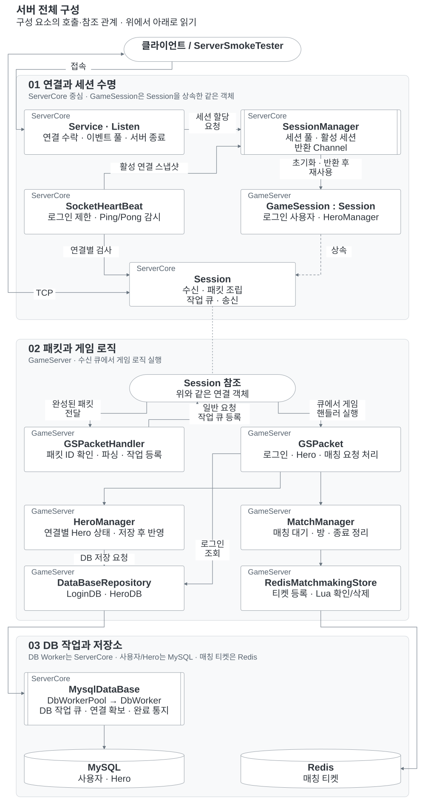

# CSharp Server Portfolio

C# / .NET 기반 비동기 TCP 게임 서버 개인 포트폴리오입니다. 기존에 직접 개발한 C++ IOCP 서버를 바탕으로 C# 서버 코어와 게임 로직을 설계·구현했습니다. 세션 수명 관리, Hero 저장의 DB·메모리 일관성, PvP 매칭과 연결 종료 처리에 집중했습니다.

## 핵심 설계

- **세션 수명 관리:** 연결 ID로 이전 연결의 작업을 구분하고, 진행 중인 I/O·비동기 작업과 정리가 끝난 뒤 세션을 재사용합니다.
- **Hero 저장 일관성:** MySQL 트랜잭션 커밋 후 요청 당시 연결이 유효한 경우에만 메모리에 반영합니다.
- **PvP 매칭:** 상태 변경을 직렬화하고, Redis 티켓의 고유 토큰을 확인해 이전 연결의 정리가 새 티켓에 영향을 주지 않도록 합니다.
- **연결 감시와 서버 종료:** 로그인·Pong 제한 시간으로 연결을 관리하고, 종료 시 저장 작업의 완료를 기다린 뒤 자원을 순서대로 정리합니다.

[설계 상세](#핵심-설계-상세) · [서버 전체 구성](#서버-전체-구성) · [실행 방법](#실행-방법)

## 검증 결과

아래 테스트와 개선 결과는 공개본에서 검증한 내용이며, 과거 서비스 운영 실적과 구분합니다.

| 검증 | 조건과 결과 | 기록 |
|---|---|---|
| 자동 테스트 | 2026-10-12 프로토콜 전환 후 재확인: ServerCore 49개 + GameServer 31개, **80개 통과** | [검토 결과](docs/PORTFOLIO_REVIEW.md) |
| 실제 저장소 통합 | MySQL 저장 후 직접 조회·재로그인 확인, Hero 복구, Redis 매칭, 연결 종료, 로그인 제한·Heartbeat 확인 | [검토 결과](docs/PORTFOLIO_REVIEW.md) |
| 여러 부하 시나리오 | 조회·저장·매칭·접속 한계 등 14개 시나리오에서 측정 실패 0건 | [부하 테스트](docs/LOAD_TEST_RESULTS.md) |
| 1시간 지속 부하 | 동시 60명, 조회 80%·저장 20%, **1,799,156건 성공 / 실패 0건**, 실제 499.76요청/초 | [장시간 테스트](docs/SOAK_TEST_RESULTS.md) |
| 세션 재사용·메모리 | 동시 60명, 준비 3회·측정 50회. 총 3,180회 로그인 후 세션 반환 확인. GC 후 관리 메모리 **8.627 → 8.622MiB** | [메모리 검증](docs/MEMORY_TEST_RESULTS.md) |

1시간 부하의 p95는 76ms, p99는 129ms였습니다(1ms 히스토그램 상한값). 서버·DB·클라이언트를 동일 PC에서 실행했고, 조회는 메모리 캐시, 저장은 실제 MySQL 트랜잭션을 사용했습니다. 이는 해당 조건의 로컬 측정값이며 운영 최대 처리량을 의미하지 않습니다.

메모리 검증에서는 종료 후 유저·매칭 상태·DB 대기 작업이 비워지고 세션 100개가 풀로 돌아왔습니다. 약 6분간의 반복 시험에서 생존 게임 객체의 지속 누적은 관찰되지 않았습니다. 모든 실행 경로의 누수 부재를 보장하는 결과는 아닙니다.

자동 테스트와 기본 통합 스모크는 저장소에 포함되어 있습니다. 부하·장시간·메모리 시험의 별도 실행기와 원본 덤프는 현재 공개본에 포함하지 않았으므로, [실행 방법](#실행-방법)의 명령만으로 해당 부하 결과를 재현할 수는 없습니다. 각 결과 문서에 측정 조건과 범위를 기록했습니다.

## 서버 전체 구성

전체도는 구성 요소의 주요 호출·참조 관계입니다. 실행 순서는 [주요 코드 호출 흐름](docs/SERVER_ARCHITECTURE.md)에서 별도로 설명합니다. `GameSession`은 `Session`을 상속한 동일 객체이며, 둘 사이에 데이터를 넘기는 별도 세션 계층은 없습니다.

연결·세션 → 패킷·게임 로직 → DB·저장소 순서로 세로 배치했습니다. 각 상자 왼쪽 위에는 소속 프로젝트를 표시합니다. `GameSession`과 기반 `Session` 기능은 **S1 테두리 안의 동일 인스턴스**입니다. 아래 패킷 구역의 S1은 그 객체를 가리키는 참조 표식입니다.

**연결 표기:** 원형 **A** 두 곳은 같은 TCP 연결을 이어 표시합니다. **S1**은 그림에서 같은 세션 객체를 나타내는 식별 표시입니다.

**도식 표기:** 마름모는 조건, 둥근 도형은 시작·결과, 이중 테두리는 큐·작업 경계, 원통은 DB를 뜻합니다.



[확대해서 보기](docs/diagrams/overview.svg) · [편집 원본](docs/diagrams/SOURCES.md#overview)

`Program`이 DB·Redis 연결, 게임 서비스, 패킷 처리기와 세션 풀을 구성합니다. `Service`는 네트워크 수명과 이벤트 풀을 관리하고, `SessionManager`는 세션의 할당과 반환을 담당합니다. Redis 연결은 `RedisManager`가 준비하여 `RedisMatchmakingStore`에 전달합니다. 매칭 대기·방 상태는 GameServer 메모리에 있으며 Redis에는 티켓을 저장합니다.

## 핵심 설계 상세

### 1. 비동기 작업이 끝난 뒤 세션 재사용

연결이 끊겨도 소켓 I/O나 DB 작업의 완료 처리는 나중에 도착할 수 있습니다. 이때 세션 객체를 먼저 재사용하면 이전 연결의 응답이나 정리가 새 연결에 영향을 줄 수 있습니다.

- 연결 ID로 작업이 시작된 연결과 현재 연결을 구분합니다.
- 진행 중인 I/O와 비동기 작업이 끝난 뒤 반환 대상으로 등록합니다.
- `Channel<Session>`의 단일 반환 작업자가 초기화·이벤트 풀 반환·참조 정리를 완료한 뒤 세션을 다시 공개합니다.
- 부분 송신에서는 전송된 구간을 제외하고 남은 구간을 이어 보냅니다. 대기 및 진행 중 송신 버퍼의 누적 바이트도 제한합니다.

코드: [Session](Server/ServerCore/Network/Session.cs), [SessionManager](Server/ServerCore/Network/SessionManager.cs) · [수정과 검증 기록](docs/SESSION_LIFETIME_REVIEW.md)

### 2. Hero 저장과 메모리 상태 일치

로그인 시 MySQL에서 Hero를 읽어 현재 연결의 메모리에 보관합니다. 이후 목록 요청은 메모리를 조회하고, 변경 요청은 아래 순서로 처리합니다.

```text
소유권·입력 검사 → MySQL 트랜잭션 갱신·조회 → 커밋
→ 요청 당시 연결이 유효한지 확인 → 메모리 반영 → 응답
```

잘못된 입력과 소유권 오류는 오류 응답으로 처리합니다. 저장 중 예외로 결과가 불명확하면 해당 연결을 종료하고, 재로그인 시 DB를 다시 읽습니다. DB 커밋 이후 연결이 종료된 경우 이전 연결의 결과를 새 연결에 반영하지 않습니다.

코드: [HeroManager](Server/GameServer/Hero/HeroManager.cs), [HeroDB](Server/GameServer/DataBase/DBRepository/HeroDB.cs), [GSPacket](Server/GameServer/Packet/GSPacket.cs)

### 3. 매칭 상태와 연결 종료 처리

매칭 참가·취소·성립·퇴장·연결 종료에 따른 상태 변경을 직렬화합니다. Redis 티켓은 연결 ID와 고유 토큰으로 구분하고, Lua로 티켓을 확인·삭제합니다. 이전 연결의 정리 요청이 새 티켓을 삭제하지 않도록 같은 토큰에만 삭제를 적용합니다.

Redis 정리 실패는 재시도하고 티켓 TTL도 적용합니다. 취소 응답은 로컬 대기 해제를 의미하며, Redis 삭제 완료를 보장하지 않습니다. 매칭 상태와 방은 **단일 서버 프로세스**가 소유합니다.

코드: [MatchManager](Server/GameServer/Matchmaking/MatchManager.cs), [RedisMatchmakingStore](Server/GameServer/Matchmaking/RedisMatchmakingStore.cs)

### 4. 연결 감시와 서버 종료

- 접속 후 DB 조회를 포함해 30초 안에 로그인을 완료해야 합니다.
- 로그인 후 Ping 간격은 10초, 유효한 Pong 대기는 30초입니다. 하나의 검사 작업자가 1초마다 확인하며 `Stopwatch`로 경과 시간을 측정합니다.
- Pong은 게임 작업 큐를 거치지 않습니다. 잘못된 번호나 중복 Pong은 제한 시간을 연장하지 않습니다.
- 서버 종료는 새 연결 수락을 중단하고, 세션·반환 작업자 → 매칭 → DB Worker·DB 연결 → Redis 순서로 기다립니다.
- 종료 작업이 오래 걸리면 10초마다 경고하며, 저장 작업을 일괄 취소하지 않습니다. 종료 시간의 상한은 보장하지 않습니다.

코드: [SocketHeartBeat](Server/ServerCore/Network/SocketHeartBeat.cs), [Program](Server/GameServer/Program.cs)

## 구조와 기술

| 구성 | 역할 |
|---|---|
| [ServerCore](Server/ServerCore) | SocketAsyncEventArgs 기반 TCP, 패킷 분할·병합 수신, 세션 큐, 버퍼 및 DB 작업 큐 |
| [GameServer](Server/GameServer) | 로그인, Hero 조회·변경, PvP 매칭 |
| [Library/protoc-35.1-win64/bin](Server/Library/protoc-35.1-win64/bin) | protobuf 원본·패킷 ID 대응표·직접 작성한 생성 도구 |
| [GameServer/Protocol](Server/GameServer/Protocol) | 생성된 protobuf C#과 PacketIds; 서버·스모크 클라이언트가 함께 사용 |
| [ServerCore.Tests](Server/ServerCore.Tests), [GameServer.Tests](Server/GameServer.Tests) | xUnit 자동 테스트, 저장소 대역 및 루프백 TCP 검증 |
| [ServerSmokeTester](ServerSmokeTester) | 실제 DB·Redis를 사용하는 통합 스모크 클라이언트 |
| [database](database), [compose.yml](compose.yml) | 로컬 MySQL 8.4·Redis 7.4, 스키마와 가상 시드 데이터 |

DB 접근에는 MySqlConnector, Redis 접근에는 StackExchange.Redis를 사용합니다. DB DTO·DBRepository·Hero 구성을 유지하며, 패킷은 `GSPacketHandler`의 ID별 등록 배열을 통해 처리합니다. 게임 핸들러의 `false` 반환은 연결 종료가 필요한 실패를 의미하고, 실제 종료는 공통 처리부에서 수행합니다.

## 실행 방법

필수: **.NET 10 SDK**. 실제 저장소를 사용하는 경우 Docker Desktop 또는 Docker Engine과 Compose가 추가로 필요합니다. Windows Docker Desktop은 WSL 2 엔진이 정상 실행된 상태여야 합니다. 아래 명령은 모두 저장소 루트에서 실행합니다.

### 서버 없이 자동 테스트

```powershell
dotnet restore CSharpServer.slnx
dotnet test CSharpServer.slnx -c Release --no-restore
```

Windows에서는 `run-tests.bat`로도 실행할 수 있습니다. Visual Studio에서는 **테스트 → 테스트 탐색기 → 모두 실행**을 사용합니다.

### MySQL·Redis와 게임 서버 실행

```powershell
docker compose up -d
docker compose logs --tail 30 mysql
docker compose exec redis redis-cli ping
```

최초 MySQL 초기화가 완료되고 최종 서버가 `port: 3306`에서 `ready for connections` 상태가 된 것을 확인합니다. Redis 응답은 `PONG`입니다. 이어서 게임 서버를 실행합니다.

```powershell
dotnet run --project Server/GameServer -c Release
```

다른 터미널에서 통합 스모크를 실행합니다.

```powershell
dotnet run --project ServerSmokeTester -c Release -- --smoke
```

성공 시 다음을 출력합니다.

```text
PASS: login, Hero update/restore, match cancel/pair/disconnect.
```

스모크는 두 명의 로그인, Hero 조회·변경·원상복구, 매칭 취소·성립·상대 연결 종료를 검사합니다. 실행 도중 강제 종료하면 Hero 값 복구가 완료되지 않을 수 있습니다. Visual Studio에서 서버를 실행할 때는 GameServer를 시작 프로젝트로 지정합니다.

| 대상 | 로컬 주소 / 계정 |
|---|---|
| 게임 서버 | `127.0.0.1:7777` |
| MySQL | `127.0.0.1:3307`, DB `csharp_demo`, 사용자 `demo`, 암호 `demo-local-only` |
| Redis | `127.0.0.1:6380` |
| 데모 로그인 | `demo-a`, `demo-b` — 비밀번호 없는 시드 계정 |

설정은 [config.json](Server/GameServer/Config/config.json)에 있습니다. 개인 환경에서 덮어쓸 값은 같은 폴더의 `config.local.json`에 두며 Git·공개 ZIP·게시 출력에서 제외합니다. 공개 암호는 로컬 예제용입니다. `database/*.sql`은 새 MySQL 볼륨을 처음 만들 때만 적용됩니다.

종료할 때는 게임 서버 터미널에서 **Ctrl+C를 누르고 정상 종료를 기다린 뒤**, 저장소를 중지합니다.

```powershell
docker compose stop
```

DB 볼륨은 보존됩니다. Docker Desktop과 WSL 자체는 이 명령으로 종료되지 않습니다.

## 프로토콜 자동 생성

프로토콜 원본은 기존 구조대로 `Server/Library/protoc-35.1-win64/bin`의 `Enum.proto`, `Struct.proto`, `Protocol.proto` 한 곳에서 관리합니다. 생성된 C#은 `Server/GameServer/Protocol`에 배치합니다. `GenPackets.bat`가 protoc로 C#을 생성하고, 직접 작성한 `GenPacketHandlers.ps1`이 패킷 ID·등록 코드·없는 핸들러의 뼈대를 갱신합니다. 기존 핸들러 구현과 등록 구간 밖의 Heartbeat Pong 처리는 보존합니다.

```powershell
.\Server\Library\protoc-35.1-win64\bin\GenPackets.bat
```

재생성에는 같은 폴더의 `protoc.exe`가 필요합니다. 실행 파일은 로컬 도구로 관리하며 Git·공개 ZIP에서는 제외합니다. 생성된 C# 파일은 저장소에 포함하므로 일반 빌드와 테스트에는 protoc가 필요하지 않습니다. 스모크 클라이언트는 동일한 생성 파일을 링크하여 컴파일합니다.

같은 `bin` 폴더의 `PacketRoutes.json`은 기존 패킷 ID·메시지·핸들러 이름의 대응표입니다. 메시지 순서 변경이나 삭제로 ID가 바뀌지 않으며, 같은 `ACK_MATCH`가 여러 응답 ID에서 사용되는 구조도 유지합니다. 상세 절차는 [프로토콜 생성 안내](Server/GameServer/Protocol/README.md)를 참고하세요.

## 범위와 한계

- 데모 로그인만 제공하며 계정 생성·실서비스 인증은 포함하지 않습니다.
- TCP 연결이 유지되면 같은 세션을 사용하고, 끊기면 다시 로그인합니다. 재접속 유예나 매칭 방 복원은 제공하지 않습니다.
- 매칭 방은 프로세스 메모리에만 존재합니다. 다중 서버 매칭·전투·보상은 구현 범위에 포함하지 않습니다.
- Hero 캐시는 현재 연결 전용이며 외부 프로세스의 DB 변경을 실시간 동기화하지 않습니다.
- 실제 DB·Redis 장애 주입, 커밋 응답 유실, DB 작업 진행 중 서버 종료는 추가 통합 검증 항목입니다. 저장소 대역을 사용한 실패 테스트와 구분합니다.

## 관련 자료와 공개본

- [업로드 전 최종 확인](docs/RELEASE_CHECKLIST.md)
- [검토 결과와 남은 검증](docs/PORTFOLIO_REVIEW.md)
- [세션 종료·재사용 수정 기록](docs/SESSION_LIFETIME_REVIEW.md)
- [공개 범위 정리](docs/PORTFOLIO_REDUCTION_PLAN.md)

PowerShell 7에서 다음 명령으로 공개용 ZIP을 만들 수 있습니다.

```powershell
pwsh -File ./export-portfolio.ps1
```

`artifacts/CSharpServer.zip`에는 공개 소스·문서·테스트·로컬 실행 자료를 담으며, 기존 Git 이력·로컬 설정·빌드 산출물·로그·`TestResults`는 제외합니다.

GitHub에 올릴 때는 ZIP을 새 폴더에 풀고, 그 안의 `CSharpServer` 폴더 내용을 저장소 루트로 사용합니다. 기존 작업 폴더의 `.git`과 로컬 백업을 함께 복사하지 않습니다.
