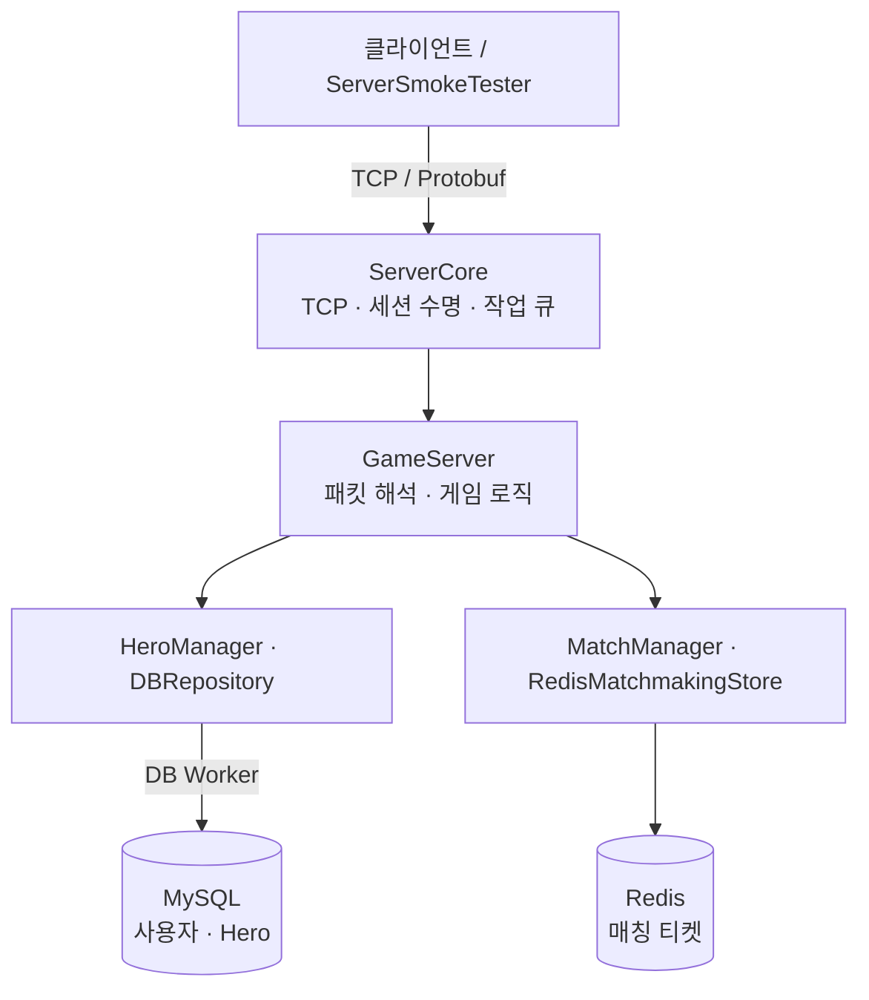

# CSharp Server Portfolio

**C# / .NET 10 비동기 TCP 게임 서버**

세션 종료·재사용, Hero의 DB·메모리 일관성, PvP 매칭 상태 관리를 구현한 포트폴리오입니다. 회사 프로젝트를 공개용으로 축소·재구성했으며, 아래 개선과 검증은 과거 서비스 운영 실적과 구분합니다.

[서버 구조](#서버-구조) · [핵심 설계](#핵심-설계) · [실행 방법](#실행-방법) · [호출 흐름도](docs/SERVER_ARCHITECTURE.md) · [검증 결과](#검증-결과)

## 서버 구조



전체도는 주요 처리 경로를 요약합니다. 응답은 세션의 송신 큐를 통해 클라이언트로 돌아갑니다. **매칭 대기·방은 GameServer 메모리**, 매칭 티켓은 Redis에 보관합니다.

| 구성 | 담당 |
|---|---|
| `Service` · `Listen` | 연결 수락, 이벤트 풀, 네트워크 시작·종료 |
| `SessionManager` | 세션 할당, 활성 연결 관리, 정리 후 풀 반환 |
| `Session` · `GameSession` | 수신·송신·작업 큐와 로그인·Hero 상태. **상속 관계인 같은 객체** |
| `GSPacketHandler` · `GSPacket` | 패킷 파싱·작업 등록과 게임 요청 처리 |

**호출 순서 자세히 보기:** [연결 수락](docs/SERVER_ARCHITECTURE.md#connection) · [패킷 처리](docs/SERVER_ARCHITECTURE.md#packet) · [세션 반환](docs/SERVER_ARCHITECTURE.md#release) · [서버 종료](docs/SERVER_ARCHITECTURE.md#shutdown)

## 핵심 설계

| 해결할 문제 | 처리 방식 | 코드 / 흐름 |
|---|---|---|
| 종료된 연결의 작업이 재사용 세션에 영향을 주는 문제 | 연결 ID 확인, 진행 중 I/O·작업 완료 후 단일 반환 작업자로 정리 | [Session](Server/ServerCore/Network/Session.cs) · [반환 흐름](docs/SERVER_ARCHITECTURE.md#release) |
| Hero 저장 실패 시 DB와 메모리가 달라지는 문제 | DB 커밋 후 현재 연결을 확인하고 메모리에 반영. 결과 불명확 시 재로그인으로 DB 재조회 | [HeroManager](Server/GameServer/Hero/HeroManager.cs) · [저장 흐름](docs/SERVER_ARCHITECTURE.md#hero) |
| 매칭·취소·연결 종료가 동시에 발생하는 문제 | 상태 변경 직렬화, 연결 ID·티켓 토큰 확인, Redis 정리 재시도 | [MatchManager](Server/GameServer/Matchmaking/MatchManager.cs) · [매칭 흐름](docs/SERVER_ARCHITECTURE.md#match) |

- **송신:** 부분 송신의 남은 구간을 이어 보내고, 대기·진행 중 송신 버퍼의 누적 바이트를 제한합니다.
- **연결 감시:** 로그인 제한 30초, Ping 간격 10초, Pong 대기 30초. Pong은 게임 작업 큐를 거치지 않습니다.
- **종료 정책:** 이미 시작한 작업의 완료를 우선하며, 오래 걸리면 10초마다 경고합니다. 강제 종료 시간 제한은 두지 않습니다.

## 검증 결과

| 항목 | 결과 | 상세 |
|---|---|---|
| 자동 테스트 | **80개 통과** — ServerCore 49개, GameServer 31개 | [검토 기록](docs/PORTFOLIO_REVIEW.md) |
| 실제 MySQL·Redis | 로그인·Hero 저장/복구·매칭·연결 종료 확인 | [검토 기록](docs/PORTFOLIO_REVIEW.md) |
| 단기 부하 | 14개 시나리오, 측정 실패 0건 | [부하 결과](docs/LOAD_TEST_RESULTS.md) |
| 1시간 부하 | 동시 60명, **1,799,156건 성공 / 실패 0건**, 499.76요청/초 | [장시간 결과](docs/SOAK_TEST_RESULTS.md) |
| 메모리·재사용 | 3,180회 로그인·종료. GC 후 관리 메모리 **8.627 → 8.622MiB** | [메모리 결과](docs/MEMORY_TEST_RESULTS.md) |

서버·DB·클라이언트를 **동일 PC**에서 측정했습니다. 1시간 부하는 조회 80%·저장 20%이며, p95 76ms·p99 129ms입니다(1ms 히스토그램 상한값). 조회는 메모리 캐시, 저장은 MySQL 트랜잭션입니다. 운영 최대 성능이나 모든 경로의 누수 부재를 보장하는 결과는 아닙니다.

자동 테스트와 기본 스모크 클라이언트는 포함되어 있습니다. 별도 부하 실행기·원본 덤프는 공개본에서 제외했으며, 자세한 조건과 실행 날짜는 각 결과 문서에 기록했습니다.

## 실행 방법

필수: **.NET 10 SDK**. 실제 저장소를 사용하는 경우 Docker Desktop 또는 Docker Engine과 Compose가 추가로 필요합니다. Windows Docker Desktop은 WSL 2 엔진이 정상 실행된 상태여야 합니다. 아래 명령은 모두 저장소 루트에서 실행합니다.

### 서버 없이 자동 테스트

```powershell
dotnet restore CSharpServer.slnx
dotnet test CSharpServer.slnx -c Release --no-restore
```

Windows에서는 `run-tests.bat`로도 실행할 수 있습니다. Visual Studio에서는 **테스트 → 테스트 탐색기 → 모두 실행**을 사용합니다.

### MySQL·Redis와 게임 서버 실행

```powershell
docker compose up -d
docker compose logs --tail 30 mysql
docker compose exec redis redis-cli ping
```

최초 MySQL 초기화가 완료되고 최종 서버가 `port: 3306`에서 `ready for connections` 상태가 된 것을 확인합니다. Redis 응답은 `PONG`입니다. 이어서 게임 서버를 실행합니다.

```powershell
dotnet run --project Server/GameServer -c Release
```

다른 터미널에서 통합 스모크를 실행합니다.

```powershell
dotnet run --project ServerSmokeTester -c Release -- --smoke
```

성공 시 다음을 출력합니다.

```text
PASS: login, Hero update/restore, match cancel/pair/disconnect.
```

스모크는 두 명의 로그인, Hero 조회·변경·원상복구, 매칭 취소·성립·상대 연결 종료를 검사합니다. 실행 도중 강제 종료하면 Hero 값 복구가 완료되지 않을 수 있습니다. Visual Studio에서 서버를 실행할 때는 GameServer를 시작 프로젝트로 지정합니다.

<details>
<summary>접속 주소·데모 계정·설정 파일</summary>

| 대상 | 로컬 주소 / 계정 |
|---|---|
| 게임 서버 | `127.0.0.1:7777` |
| MySQL | `127.0.0.1:3307`, DB `csharp_demo`, 사용자 `demo`, 암호 `demo-local-only` |
| Redis | `127.0.0.1:6380` |
| 데모 로그인 | `demo-a`, `demo-b` — 비밀번호 없는 시드 계정 |

설정은 [config.json](Server/GameServer/Config/config.json)에 있습니다. 개인 환경에서 덮어쓸 값은 같은 폴더의 `config.local.json`에 두며 Git·공개 ZIP·게시 출력에서 제외합니다. 공개 암호는 로컬 예제용입니다. `database/*.sql`은 새 MySQL 볼륨을 처음 만들 때만 적용됩니다.

</details>

종료할 때는 게임 서버 터미널에서 **Ctrl+C를 누르고 정상 종료를 기다린 뒤**, 저장소를 중지합니다.

```powershell
docker compose stop
```

DB 볼륨은 보존됩니다. Docker Desktop과 WSL 자체는 이 명령으로 종료되지 않습니다.

## 프로토콜 자동 생성

```text
Library/protoc-35.1-win64/bin/
  *.proto + PacketRoutes.json
              ↓ GenPackets.bat / GenPacketHandlers.ps1
GameServer/Protocol/*.cs + 패킷 등록 코드
```

직접 작성한 생성 도구가 **패킷 ID·등록 코드·없는 핸들러만 추가**하고 기존 구현을 보존합니다. ID는 선언 순서에 의존하지 않도록 대응표에서 관리합니다.

```powershell
.\Server\Library\protoc-35.1-win64\bin\GenPackets.bat
```

재생성 시 같은 폴더에 `protoc.exe`가 필요합니다. 생성 C#은 저장소에 포함되어 **일반 빌드에는 protoc가 필요하지 않습니다.** 스모크 클라이언트도 같은 생성 파일을 사용합니다. [생성 방법 자세히 보기](Server/GameServer/Protocol/README.md)

## 프로젝트 구성

| 경로 | 내용 |
|---|---|
| [Server/ServerCore](Server/ServerCore) | 공통 TCP·세션·DB 작업 라이브러리 |
| [Server/GameServer](Server/GameServer) | 로그인·Hero·매칭 |
| [Server/Library](Server/Library) | proto 원본·생성 도구 |
| [ServerCore.Tests](Server/ServerCore.Tests) · [GameServer.Tests](Server/GameServer.Tests) | xUnit 자동 테스트 |
| [ServerSmokeTester](ServerSmokeTester) | 통합 스모크 클라이언트 |
| [database](database) · [compose.yml](compose.yml) | 로컬 MySQL·Redis·가상 데이터 |

사용 기술: .NET 10, SocketAsyncEventArgs, Google.Protobuf, MySqlConnector, StackExchange.Redis, xUnit.

## 범위와 한계

- 데모 로그인만 제공합니다. 실서비스 인증·계정 생성은 포함하지 않습니다.
- 연결이 끊기면 다시 로그인합니다. 재접속 유예·매칭 방 복원은 제공하지 않습니다.
- 단일 서버의 매칭입니다. 다중 서버 매칭·전투·보상은 포함하지 않습니다.
- 외부 프로세스의 DB 변경은 현재 연결의 Hero 캐시에 실시간 반영하지 않습니다.
- 실제 저장소 장애 주입·커밋 응답 유실·DB 작업 중 종료는 추가 통합 검증 항목입니다.

<details>
<summary>추가 문서와 공개 ZIP 만들기</summary>

- [서버 구조와 주요 호출 순서](docs/SERVER_ARCHITECTURE.md)
- [세션 종료·재사용 수정 기록](docs/SESSION_LIFETIME_REVIEW.md)
- [공개 범위 정리](docs/PORTFOLIO_REDUCTION_PLAN.md)
- [업로드 전 최종 확인](docs/RELEASE_CHECKLIST.md)

PowerShell 7에서 실행합니다.

```powershell
pwsh -File ./export-portfolio.ps1
```

`artifacts/CSharpServer.zip`에 공개 소스·문서·테스트·실행 자료를 담습니다. Git 이력·개인 설정·빌드 결과·로그·TestResults는 제외합니다. ZIP 안의 CSharpServer 폴더 내용을 새 저장소의 루트로 사용합니다.

</details>
