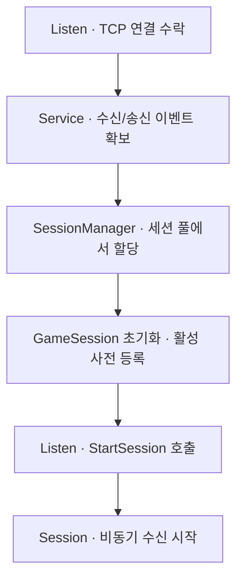
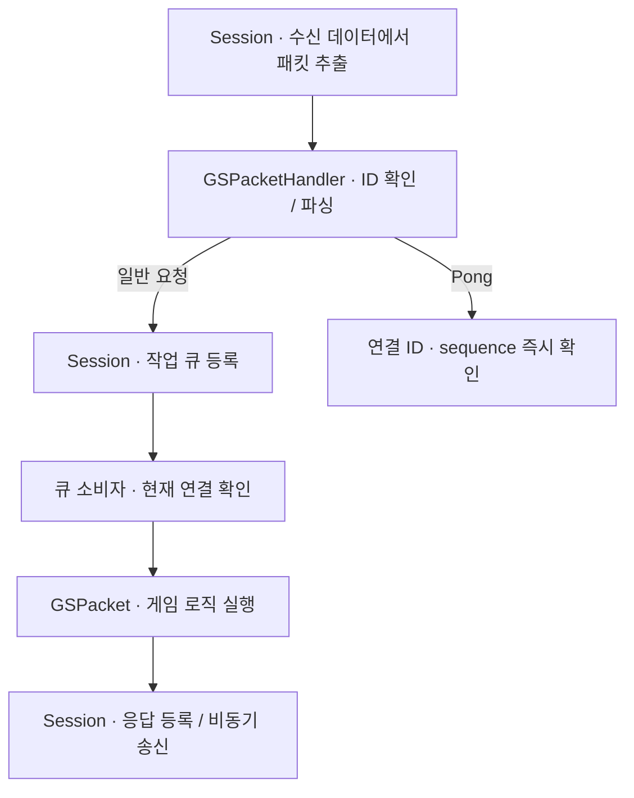
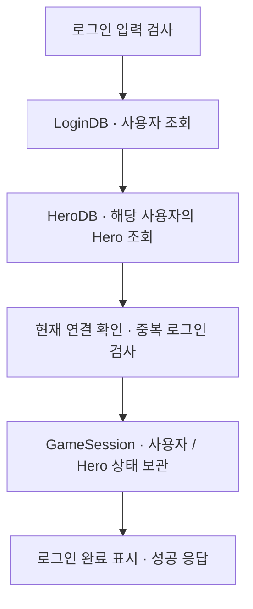
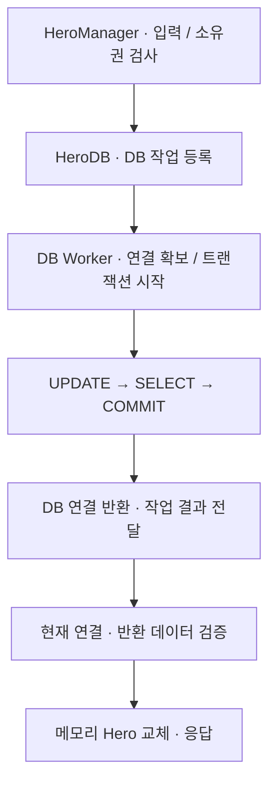
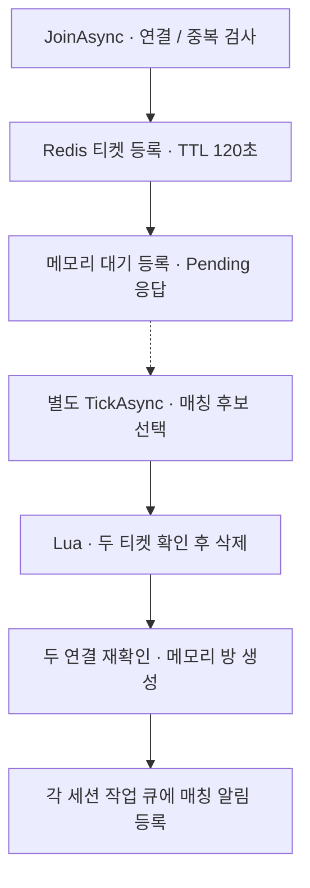
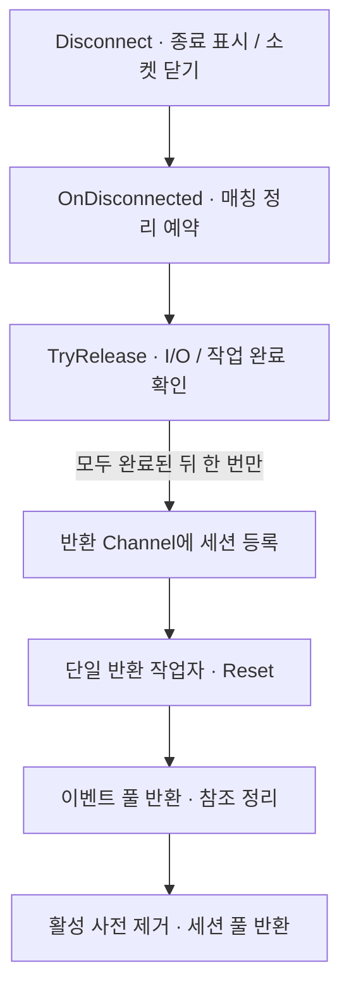
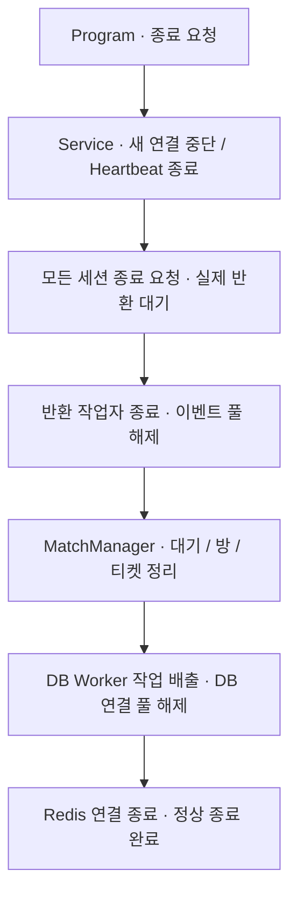

# 서버 호출 흐름

[전체 구성도 보기](../README.md#서버-구조)

현재 코드의 주요 경로를 **위에서 아래로** 읽도록 정리했습니다. 각 그림 아래에서 실제 메서드와 실패 처리를 펼쳐 볼 수 있습니다.

| 연결과 요청 | 게임 로직 | 종료와 정리 |
|---|---|---|
| [1. 연결 수락](#connection) | [3. 로그인](#login) | [6. 세션 반환](#release) |
| [2. 패킷 처리](#packet) | [4. Hero 저장](#hero) | [7. 서버 종료](#shutdown) |
| | [5. 매칭](#match) | |

## 1. 연결 수락과 세션 할당

접속할 때 풀에서 세션을 꺼내 초기화하고 수신을 시작합니다.

**초기 준비:** Program이 DB·Redis와 게임 서비스를 구성하고, SessionManager의 세션 풀·반환 작업자를 준비합니다. Service는 이벤트 풀과 Listen·Heartbeat를 관리합니다.

실제 메서드와 예외 처리

| 단계 | 메서드 |
|---|---|
| 시작 | `Program.Main` → `SessionManager.Initialize` → `Service.StartServer` |
| 접속 수락 | `Listen.ProcessAccept` → `ReadPool.Pop` / `WritePool.Pop` |
| 세션 할당 | `SessionManager.CreateSession` → `Session.Initialize` |
| 수신 시작 | `Listen` → `session.StartSession` |

이벤트나 사용 슬롯이 부족하면 연결을 거절합니다. 세션 생성 전 실패한 자원은 Listen이 반환하고, 생성 후 자원은 세션 종료 경로에서 정리합니다. GameSession은 Session을 상속한 같은 객체입니다.

[Listen 코드](../Server/ServerCore/Network/Listen.cs) · [SessionManager 코드](../Server/ServerCore/Network/SessionManager.cs)

## 2. 패킷 처리와 응답

일반 요청은 파싱한 뒤 세션별 작업 큐에서 순서대로 처리합니다.

**Pong은 큐를 거치지 않습니다.** 게임 로직이 DB 응답을 기다리는 중에도 Heartbeat를 처리할 수 있습니다.

실제 메서드와 예외 처리

| 단계 | 메서드 |
|---|---|
| 패킷 추출 | `ProcessReceive` → `OnRecv` → `OnRecvPack` |
| 파싱·등록 | `GSPacketHandler.HandlePacket` → ID별 delegate → `EnqueueAsyncJob` |
| 게임 처리 | `ProcessRecvQueueAsync` → `HandleAsync` → `GSPacket.HandleReq…` |
| 응답 | `SendPacket` → `Send` → 비동기 송신 / `ProcessSend` |
| Pong | `ReceiveHeartbeatPong` |

그림의 응답은 응답을 보내는 요청의 대표 경로입니다. `true`는 오류 ACK를 포함한 처리 완료 또는 추가 처리 불필요이며, 항상 송신했다는 뜻은 아닙니다. `false` 또는 처리 예외는 공통 처리부에서 요청 당시 연결을 종료합니다. 파싱·큐 등록 실패도 연결 종료로 이어집니다. 부분 송신이면 남은 구간을 이어 보냅니다.

[Session 코드](../Server/ServerCore/Network/Session.cs) · [GSPacketHandler 코드](../Server/GameServer/Packet/GSPacketHandler.cs)

## 3. 로그인과 Hero 로드

로그인할 때 DB에서 사용자와 Hero를 읽어 현재 연결에 보관합니다.

**이후 Hero 목록 요청은 메모리를 조회합니다.** 목록 요청마다 MySQL을 읽는 구조는 아닙니다.

실제 메서드와 예외 처리

| 단계 | 메서드 |
|---|---|
| 요청 | `GSPacket.HandleReqLogin` |
| DB 조회 | `LoginDB.FindAsync` → `HeroDB.LoadAsync` (각각 DB Worker 사용) |
| 연결 등록 | `IsCurrentConnection` → `GameSession.Login` → `UserSessions.TryLogin` |
| 상태 보관 | `Heroes.Load` → `MarkLoginCompleted` → `SendPacket` |

그림은 성공 경로입니다. 입력이 잘못되거나 사용자가 없으면 실패 응답이며, 사용자가 없을 때 Hero 조회는 하지 않습니다. 중복 로그인도 거절합니다. 연결이 이미 종료됐으면 상태 반영·응답을 생략합니다. 로그인 데이터 오류는 연결 종료로, 일반 조회 예외는 실패 응답으로 처리합니다.

[GSPacket 코드](../Server/GameServer/Packet/GSPacket.cs) · [GameSession 코드](../Server/GameServer/Sessions/GameSession.cs)

## 4. Hero 저장과 메모리 반영

DB 저장이 성공한 뒤에만 메모리의 Hero를 갱신합니다.

**커밋 결과가 불명확하면 연결을 종료합니다.** 재로그인 때 DB를 읽어 확정 상태를 확인합니다.

실제 메서드와 예외 처리

| 단계 | 메서드 |
|---|---|
| 게임 요청 | `HandleReqHeroUpdate` → `HeroManager.UpdateAsync` |
| 작업 등록 | `HeroDB.UpdateAsync` → `MysqlDataBase.ExecuteAsync` |
| 저장 | `DbJob.ExecuteAsync`에서 HeroDB 작업 delegate 실행 |
| 트랜잭션 | `BeginTransactionAsync` → UPDATE / SELECT → `CommitAsync` |
| 완료 | 연결 Dispose → Completion 완료 → HeroManager에서 연결·ID 확인 |

입력·소유권 오류는 DB 접근 전에 오류 결과를 반환합니다. Hero가 없거나 연결이 종료됐으면 메모리를 갱신하지 않습니다. 커밋 직후 연결이 끊기면 DB 결과는 남고, 이전 연결의 메모리·응답에는 반영하지 않습니다. 저장 예외는 게임 핸들러가 false를 반환하여 해당 연결을 종료합니다.

[HeroManager 코드](../Server/GameServer/Hero/HeroManager.cs) · [HeroDB 코드](../Server/GameServer/DataBase/DBRepository/HeroDB.cs) · [DbJob 코드](../Server/ServerCore/DataBase/DataBaseJob.cs)

## 5. 매칭 참가와 성립

참가는 대기 등록이고, 실제 짝짓기는 별도 매칭 작업자가 처리합니다.

**연결 종료:** `ScheduleDisconnect`로 정리를 예약하고, 다음 Tick에서 해당 연결의 대기·방을 정리합니다. 이 정리와 세션 풀 반환은 별도 흐름입니다.

실제 메서드와 예외 처리

| 단계 | 메서드 |
|---|---|
| 참가 | `HandleReqPvpMatchPending` → `JoinAsync` → 저장소 `AddAsync` |
| 성립 | `TickAsync` → `ClaimAsync` → Room 생성 → `GameSession.Notify` |
| 알림 | `EnqueueAsyncJob(connectionId, …)` → 현재 연결 확인 → `SendPacket` |
| 종료 | `OnDisconnected` → `ScheduleDisconnect` → 다음 Tick의 `DisconnectAsync` |
| 티켓 정리 | `FlushCleanupAsync` → 저장소 `RemoveAsync` |

그림은 성공 경로입니다. 참가·취소·매칭·정리는 gate로 직렬화합니다. 티켓 소비에 실패하거나 연결이 무효하면 FailPair로 정리하고 종료 알림을 보냅니다. Redis 등록·삭제 결과가 불명확하면 정리 대상으로 남겨 재시도합니다. 삭제는 동일 토큰에만 적용됩니다. 매칭 작업자는 Tick 완료 후 100ms 대기합니다.

[MatchManager 코드](../Server/GameServer/Matchmaking/MatchManager.cs) · [RedisMatchmakingStore 코드](../Server/GameServer/Matchmaking/RedisMatchmakingStore.cs)

## 6. 연결 종료와 세션 재사용

종료 요청을 받았다고 바로 세션을 풀에 돌려주지 않습니다.

**아직 작업이 남아 있으면 반환하지 않습니다.** 작업 완료 경로에서 TryRelease를 다시 호출합니다. 별도 루프가 계속 검사하는 방식은 아닙니다.

실제 메서드와 예외 처리

| 단계 | 메서드 |
|---|---|
| 종료 | `Session.Disconnect(connectionId)` → `GameSession.OnDisconnected` |
| 반환 예약 | `TryRelease` → `SessionManager.ReleaseRegister` |
| 정리 | `StartRelease` → `Reset` → `RetrunEventArgs` |
| 재사용 공개 | 활성 사전 제거 → 세션 큐 등록 → 사용 슬롯 반환 |

Reset은 유저 등록과 Hero 상태도 정리합니다. 이벤트 반환·참조 정리 전에는 세션을 다음 연결에 공개하지 않습니다. 반환 Channel 등록과 재사용 가능한 풀 등록은 서로 다른 시점입니다. `RetrunEventArgs`는 현재 코드의 철자를 그대로 사용했습니다.

[Session 코드](../Server/ServerCore/Network/Session.cs) · [SessionManager 코드](../Server/ServerCore/Network/SessionManager.cs)

## 7. 서버 종료

세션 정리를 먼저 마친 뒤, 의존하는 저장소 자원을 해제합니다.

**10초는 강제 종료 제한이 아닙니다.** 각 단계가 오래 걸리면 경고하며 완료를 계속 기다립니다.

실제 메서드와 예외 처리

| 단계 | 메서드 |
|---|---|
| 네트워크 | `StopServerAsync` → `StopAsyncListen` → Heartbeat 취소·대기 |
| 세션 | `AllReleaseSessionAsync` → Disconnect → 반환 완료 대기 |
| 반환 작업자 | Channel 완료 → `_releaseTask` 대기 → 이벤트 풀 Dispose |
| 게임·저장소 | `MatchManager.DisposeAsync` → `MysqlDataBase.DisposeAsync` → `RedisManager.ShutdownAsync` |

종료 Task를 반복 요청해도 같은 Task를 반환합니다. 실제 정리 오류는 기록 후 예외로 전달되며, 이후 자원을 정상 해제한 것으로 처리하지 않습니다. Redis 티켓 정리 실패는 재시도·TTL 정책을 따릅니다.

[Program 코드](../Server/GameServer/Program.cs) · [Service 코드](../Server/ServerCore/Network/Service.cs)

---

프로토콜 생성은 서버 실행 중의 호출 흐름과 별개입니다. `bin`의 원본을 기존 생성 도구로 처리해 C#과 패킷 등록 코드를 만듭니다. [프로토콜 생성 안내](../Server/GameServer/Protocol/README.md)
