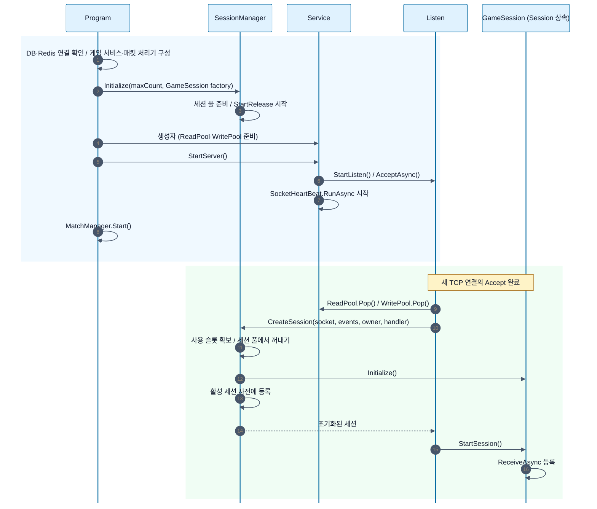
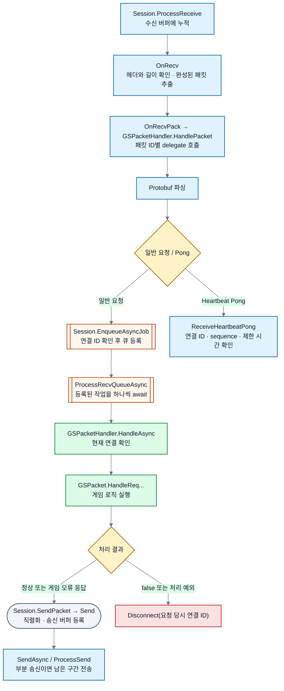
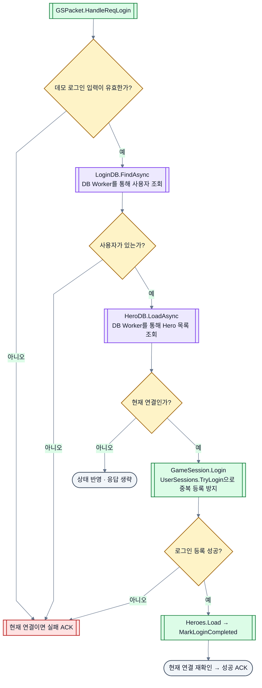
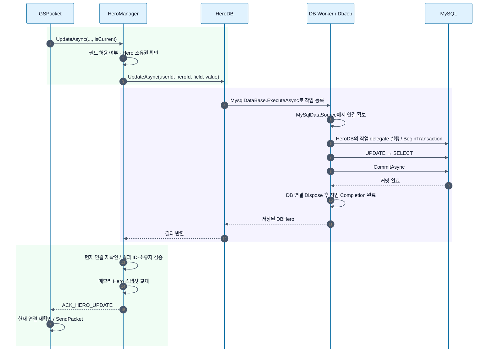
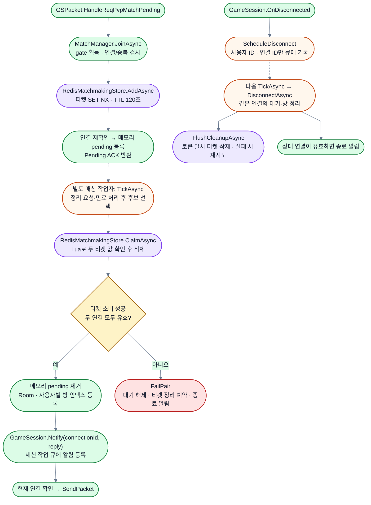
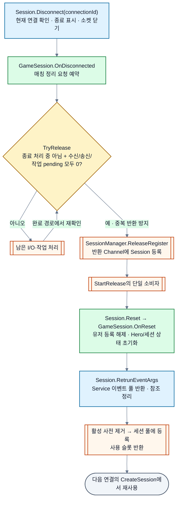
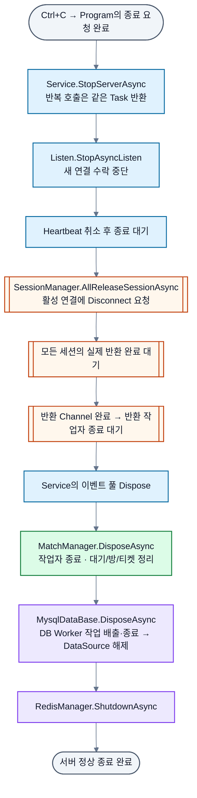

# 서버 구성과 주요 호출 흐름

2026-10-12 현재 코드 기준입니다. [전체 구성도](../README.md#서버-전체-구성)는 클래스의 관계를, 아래 도식은 주요 메서드의 실행 순서를 설명합니다. 실선 흐름은 호출·진행, 점선은 반환 결과나 비동기 후속 처리를 나타냅니다. 실패 경로는 상태와 수명에 영향을 주는 경우를 중심으로 표시했습니다.

**도식 표기:** 파랑은 네트워크, 초록은 게임 로직, 보라는 저장소, 주황은 큐·작업자, 노랑 마름모는 조건, 빨강은 실패 처리입니다. 둥근 도형은 시작·결과, 이중 테두리는 큐·작업 경계, 원통은 DB를 뜻합니다.

시퀀스 다이어그램은 호출 번호와 배경 영역으로 준비·DB 처리·상태 반영 단계를 구분합니다.

## 1. 시작 · 연결 수락 · 세션 할당

세션은 접속 때마다 새로 생성하는 것이 아니라 초기화 시 준비한 객체를 재사용합니다. 위 세션 생성 흐름은 정상 경로입니다. 이벤트나 슬롯이 부족하면 연결을 거절하고, 생성 이전에 확보한 자원은 `Listen`이 반환합니다. 세션 생성 후의 자원 반환은 세션 종료 경로가 담당합니다. `StartListen()` 호출 중 연결이 먼저 수락될 수도 있어, Heartbeat·매칭 작업자의 시작과 개별 접속 시점 사이에 엄격한 선후 관계를 가정하지 않습니다.

코드: [Program](../Server/GameServer/Program.cs), [Listen](../Server/ServerCore/Network/Listen.cs), [SessionManager](../Server/ServerCore/Network/SessionManager.cs)

## 2. 패킷 수신 · 파싱 · 게임 로직 · 응답

위 응답 경로는 응답을 보내는 일반 요청의 대표 흐름입니다. `true`는 오류 ACK를 포함한 처리 완료 또는 추가 처리 불필요를 뜻하며, 항상 송신했다는 뜻은 아닙니다. 예를 들어 이미 종료된 연결은 응답 없이 끝날 수 있습니다. 일반 핸들러의 파싱 실패·큐 등록 실패는 `false`로 수신 경로에 전달되어 연결 종료로 이어집니다. Pong은 게임 작업 큐에 넣지 않아 DB 작업 뒤에서 대기하지 않습니다.

코드: [Session](../Server/ServerCore/Network/Session.cs), [GSPacketHandler](../Server/GameServer/Packet/GSPacketHandler.cs), [GSPacket](../Server/GameServer/Packet/GSPacket.cs)

## 3. 로그인과 Hero 최초 로드

일반적인 입력·조회·로그인 등록 분기를 표시했습니다. 로그인 데이터 오류는 연결 종료로, 일반 조회 예외는 로그인 실패 응답으로 이어집니다. 사용자가 없으면 Hero 조회는 하지 않습니다. 이후 Hero 목록 요청은 로그인 시 읽은 메모리 상태를 조회하며 매번 MySQL에 접근하지 않습니다.

코드: [GSPacket.HandleReqLogin](../Server/GameServer/Packet/GSPacket.cs), [LoginDB](../Server/GameServer/DataBase/DBRepository/LoginDB.cs), [HeroDB](../Server/GameServer/DataBase/DBRepository/HeroDB.cs)

## 4. Hero 갱신의 DB·메모리 반영 순서

이는 유효한 요청의 저장 성공 경로입니다. 입력·소유권 검사 실패는 저장 전에 오류 결과를 반환합니다. DB가 Hero를 찾지 못하면 메모리를 갱신하지 않습니다. 커밋 후 연결이 끊겼다면 DB 결과는 남지만 이전 연결의 메모리·응답에는 반영하지 않습니다. 저장 예외는 `HandleReqHeroUpdate`가 `false`로 반환하여 공통 처리부에서 해당 연결을 종료합니다. 저장 결과가 불명확할 때는 재로그인 조회로 확정 상태를 읽습니다.

코드: [HeroManager.UpdateAsync](../Server/GameServer/Hero/HeroManager.cs), [HeroDB.UpdateAsync](../Server/GameServer/DataBase/DBRepository/HeroDB.cs), [DbJob.ExecuteAsync](../Server/ServerCore/DataBase/DataBaseJob.cs)

## 5. 매칭 참가 · 성립 · 연결 종료

`JoinAsync`는 대기 등록을 수행하고 실제 짝짓기는 별도 `TickAsync`에서 합니다. 매칭 작업자는 Tick 완료 후 100ms 대기하므로 정확히 100ms마다 완료되는 타이머가 아닙니다. 참가 실패 경로는 중복/연결 오류 또는 저장소 오류 결과를 반환하며, Redis 등록 결과가 불명확하면 티켓을 정리 대상으로 남깁니다.

참가·취소·퇴장·매칭·정리는 `_gate`로 직렬화합니다. `ScheduleDisconnect`는 정리 예약이며 Redis 작업 완료를 기다리지 않습니다. 세션 반환은 이 매칭 정리 완료에 종속되지 않고, 이전 연결 ID·토큰 검사가 뒤늦은 정리를 보호합니다. 게임 상태는 메모리, 티켓은 Redis에 있다는 책임 분리가 중요합니다.

코드: [MatchManager](../Server/GameServer/Matchmaking/MatchManager.cs), [RedisMatchmakingStore](../Server/GameServer/Matchmaking/RedisMatchmakingStore.cs), [GameSession](../Server/GameServer/Sessions/GameSession.cs)

## 6. 연결 종료 · 세션 반환 · 재사용

`TryRelease`는 별도 감시 루프가 아니라 종료·I/O·큐 작업 완료 경로에서 호출됩니다. 세션을 반환 Channel에 넣는 시점과 풀에 다시 공개하는 시점은 다릅니다. 이벤트와 참조 정리가 끝나기 전에는 새 연결에 재사용하지 않습니다. 코드의 `RetrunEventArgs` 이름은 현재 철자를 그대로 표기했습니다.

코드: [Session.Disconnect / TryRelease / Reset](../Server/ServerCore/Network/Session.cs), [SessionManager.StartRelease](../Server/ServerCore/Network/SessionManager.cs)

## 7. 서버 종료

`Program.WaitForShutdownAsync`는 각 단계가 10초 이상 지속되면 경고를 반복하며 같은 작업을 계속 기다립니다. 강제 종료 시간 제한은 아닙니다. 실제 종료 오류가 발생하면 기록하고 예외를 전달하며, 이후 단계를 정상 완료한 것으로 처리하지 않습니다. Redis 티켓 삭제 실패는 매칭 정리의 재시도/TTL 정책을 따릅니다.

코드: [Program](../Server/GameServer/Program.cs), [Service.StopServerCoreAsync](../Server/ServerCore/Network/Service.cs), [SessionManager](../Server/ServerCore/Network/SessionManager.cs), [MysqlDataBase](../Server/ServerCore/DataBase/DataBase.cs)

## 프로토콜 생성은 실행 흐름과 별개

`bin/*.proto + PacketRoutes.json → GenPackets.bat / GenPacketHandlers.ps1 → GameServer/Protocol/*.cs 및 패킷 등록 코드` 순서로 생성합니다. 이는 개발 단계의 코드 생성 과정이며 서버 실행 중 자동으로 도는 작업이 아닙니다. [생성 안내](../Server/GameServer/Protocol/README.md)를 참고하세요.
